# Cloud Deployment

**Course:** Software Engineering
**Topic:** Cloud
**Tech Stack:** React, TypeScript, Vite (client) · Express, Kysely, PostgreSQL (server)
**Total Points:** 20 Points

---

## Overview

For this project, you will deploy the attached application to Render. Follow the instructions in this README to set up your application.

## Requirements

### Log in to GHCR

In GitHub, navigate to Settings -> Developer Settings to configure a Personal access token (PAT) using the Tokens (classic) menu as shown below:

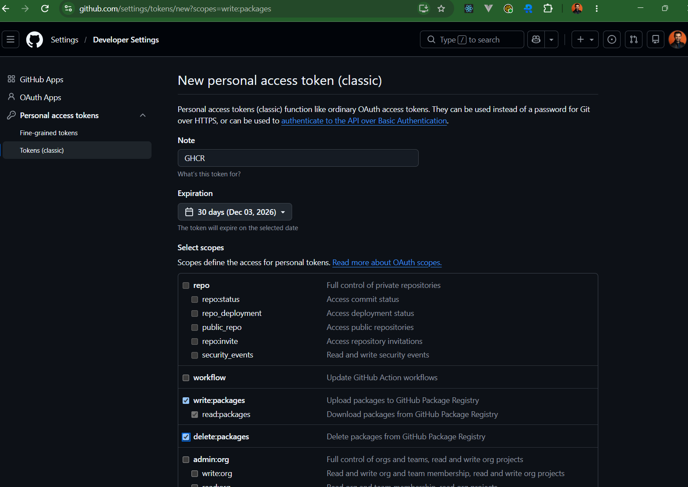

Next, `cd` into the `server` directory, save the token in a `github-token.txt` file, and run (Replace USERNAME with your actual GitHub username):

```bash
cat github-token.txt | docker login ghcr.io -u USERNAME --password-stdin
```

It should print "Login Succeeded". If it does not, make sure you have the right scopes above for your token.

This logs you into the GitHub Container Registry (GHCR) to push your Docker image.

### Build and Push the Docker Image

First, create a `Dockerfile` inside the `server` directory with the following contents:

```dockerfile
# =============================================================================
# Stage 1 — Builder
# Install all dependencies (including devDependencies) and compile TypeScript
# =============================================================================
FROM node:24-alpine AS builder

WORKDIR /app

# Copy manifests first so Docker can cache the npm install layer
COPY package*.json ./

# Install everything — devDependencies are needed here for tsc
RUN npm ci

# Copy source
COPY tsconfig.json ./
COPY src ./src

# Compile TypeScript to JavaScript
RUN npx tsc

# =============================================================================
# Stage 2 — Runner
# Copy only the compiled output and production dependencies into a clean image
# =============================================================================
FROM node:24-alpine AS runner

WORKDIR /app

# Copy manifests again so we can do a production-only install
COPY package*.json ./

# Install only production dependencies — no devDependencies
RUN npm ci --omit=dev

# Copy the compiled JS from the builder stage
COPY --from=builder /app/dist ./dist

# Change ownership of the app directory to the non-root 'node' user
RUN chown -R node:node /app

# Switch to the non-root user
USER node

EXPOSE 8080

# Run plain node against the compiled entry point
CMD ["node", "dist/index.js"]
```

Next, run the following inside the `server` directory to build your docker image locally (Replace USERNAME with your actual GitHub username and note that the npm ci commands can take a while):

```bash
docker build -f Dockerfile -t assignment-07:latest .
docker build -f Dockerfile -t ghcr.io/USERNAME/assignment-07:latest .
```

You can verify it built properly by running a container from the built image:

```bash
docker compose -f docker-compose.dev.yml up
```

and visiting `http://localhost:8080/health` to make sure the health endpoint works and the server is running.

Once built, push your built image to GHCR (Replace USERNAME with your actual GitHub username):

```bash
docker push ghcr.io/USERNAME/assignment-07:latest
```

You should be able to verify in your GitHub account that your image is pushed properly:

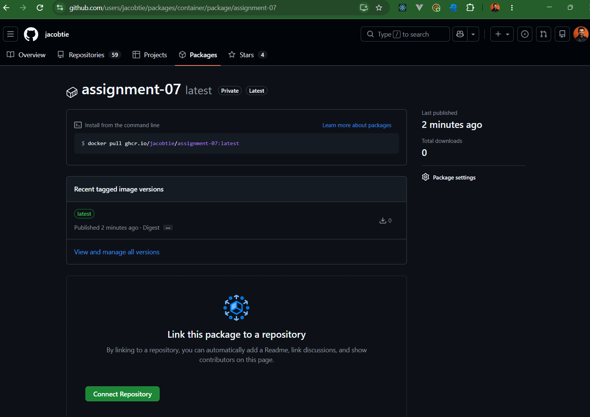

### Setup Render

Navigate to [render.com](https://render.com/) and create an account. You can log in with GitHub if that is easiest, it does not matter.

Once you have an account, create a Project for `assignment-07` to group all the components (Database, Backend, Frontend).

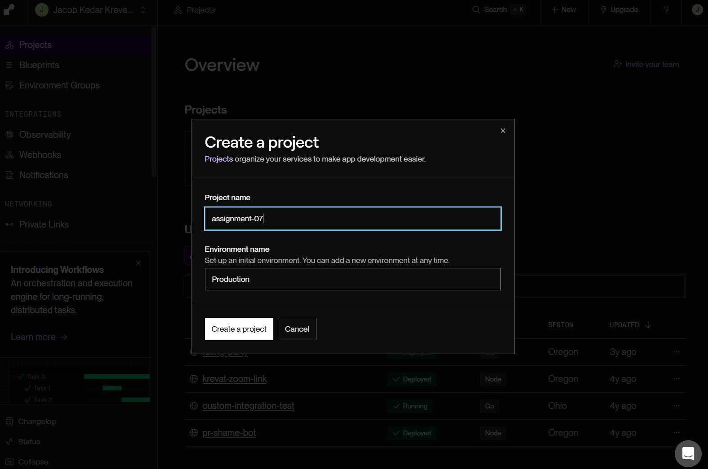

### Setup Postgres

Next, create a new Postgres service in your project with the following settings changed (make sure you create a free DB):

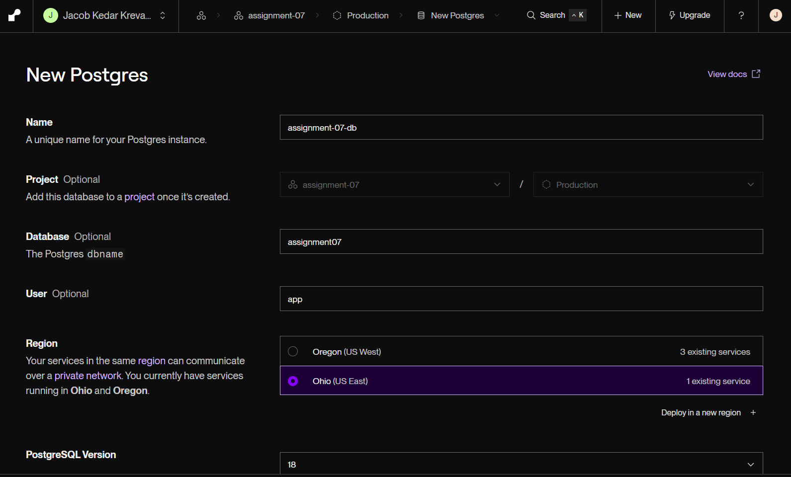
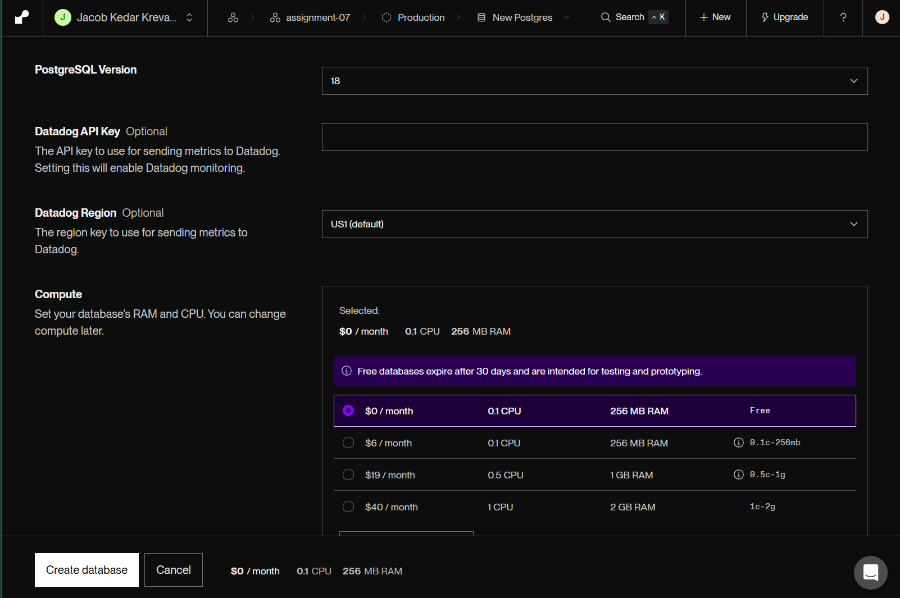

### Setup Web Service

Next, create a new Web Service in your project using an Existing Image with your GitHub username and PAT:

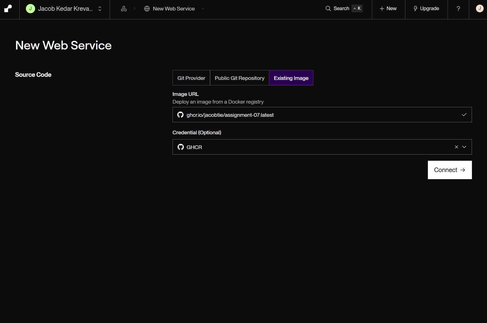
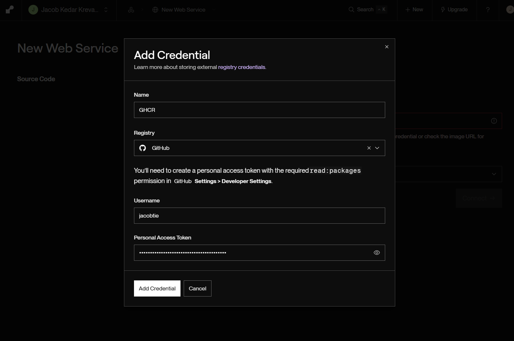

Next, fill in the following settings for your web service:

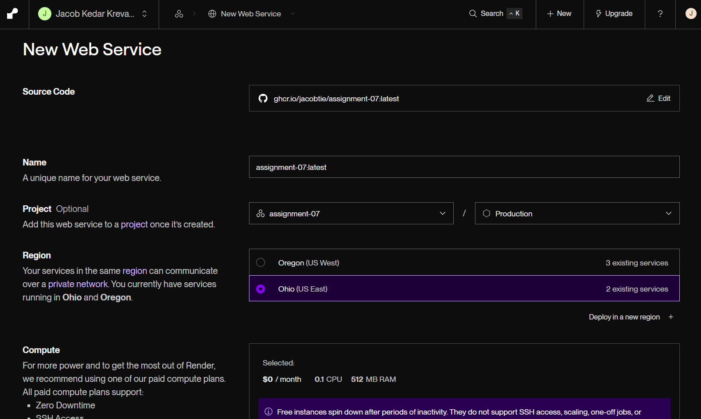
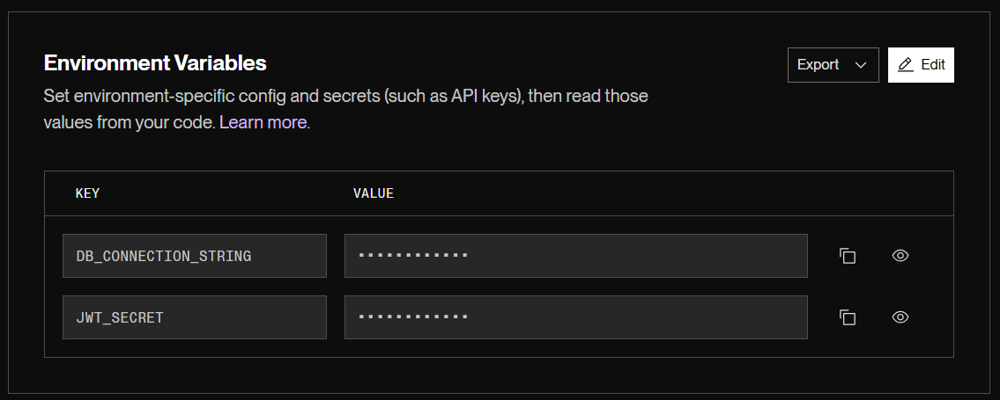

Note that you can generate a random `JWT_SECRET` and you need to get the value of `DB_CONNECTION_STRING` from the Postgres database you set up in Render in the upper right hand corner under "Connect" and "Internal".

### Setup Frontend

Next, create a Static Site in your project.

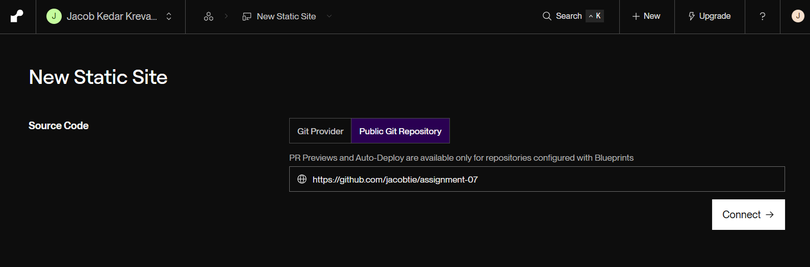

Next, fill in the following settings for your static site so that Render builds it properly:

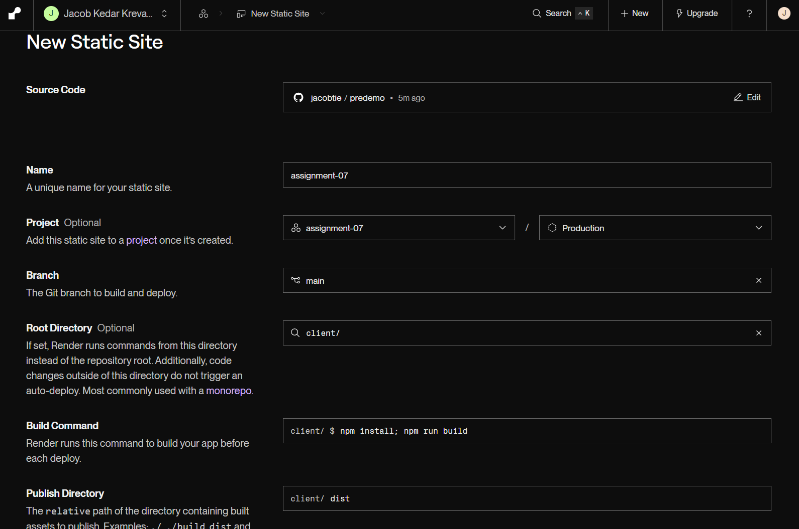

Next, navigate to your new Static Site's Redirects/Rewrites section and add a new rule with the source `/api/*` and the destination `https://YOUR_RENDER_HOST/*` with the action `Rewrite`.

### Verify

Visit your site and make sure it works!
